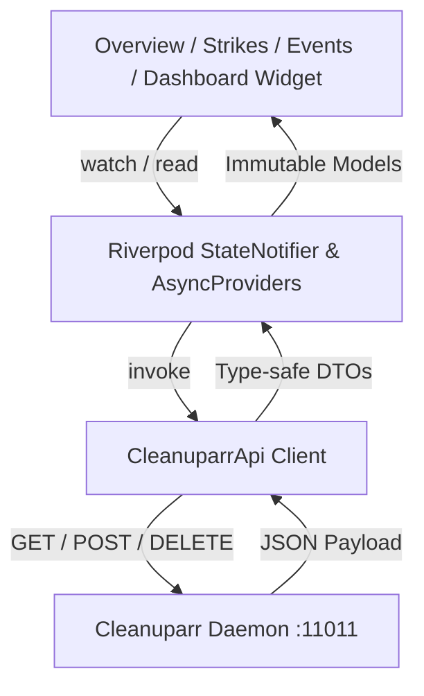

# Cleanuparr Service (`service_cleanuparr`)

`service_cleanuparr` provides Atrium's native client and mobile interface for [Cleanuparr](https://github.com/Cleanuparr/Cleanuparr), the automated malware blocker and queue cleaner for the Servarr ecosystem and download clients.

## Architecture & REST Protocol

Cleanuparr exposes an ASP.NET Core REST API on default port `11011`. Authentication is performed via Servarr-style API key (`X-Api-Key` header).



### 1. Target Endpoints
- **Health & System Status**: `GET /api/status`
  - System version, uptime, memory usage (MB), connected media managers (Sonarr, Radarr, Lidarr), and download clients (qBittorrent, Transmission, Deluge).
- **Aggregated Statistics**: `GET /api/v2/stats?hours={hours}&includeDryRun=false`
  - Total events, strike activities, malware removals (`allFilesBlocked`, `atLeastOneFileBlocked`), cleaned torrents, and Seeker searches across selectable timeframes (24h, 7d, 30d).
- **Strikes Ledger**: `GET /api/strikes?page=1&pageSize=50&search=`
  - Active items accumulating strikes, per-item strike totals and type breakdowns, removal state, info-hashes, and timestamps.
  - The active count comes from `getActiveStrikesCount()`: it reads one page of 500 (the backend's largest) without the search text and leaves out items Cleanuparr already removed (`isRemoved == true`). Items past that page count as active, from the envelope's `totalCount`.
- **Strike Reset Action**: `DELETE /api/strikes/{downloadItemId}`
  - Clears accumulated strikes for an item with confirmation dialog.
- **Audit Feed**: `GET /api/events?page=1&pageSize=50&eventType=&severity=&search=`
  - Chronological audit events with severity levels, release title, torrent hash, and deletion reasons.
  - Text search is answered server-side. Category chips are evaluated client-side over up to 3 x 500 events (backend `Pagination.MaxPageSize`) because the backend accepts only a single scalar `eventType`; `Cleaned` maps to the exact `DownloadCleaned` enum member and runs fully server-side.
- **Background Cleaner Jobs**: `GET /api/jobs` & `POST /api/jobs/{jobType}/trigger`
  - Background task inspection (`MalwareBlocker`, `QueueCleaner`, `DownloadCleaner`, `Seeker`, etc.) and instant on-demand job runs.

### 2. Design System & Ergonomics
- **Material 3 Dynamic Theming**: Strictly zero hardcoded hex or material constant colors. Every color resolves through `Theme.of(context).colorScheme`.
- **3-Tab Navigation (`CleanuparrHome`)**:
  - **Overview**: System status card, timeframe segmented control, 4 operational metric cards, and background jobs list.
  - **Strikes**: Live strikes count badge on bottom nav, instant substring search, item cards with strike counters & breakdown tags, and clean queue empty state.
  - **Events**: Search bar, category filter chips (`All`, `Malware`, `Strikes`, `Deletions`, `Cleaned`), audit log feed with severity indicators, and detail bottom sheet.
- **EasyRefresh & Physics**:
  - All tabs use `EasyRefresh` wrapped with `AlwaysScrollableScrollPhysics` so pull-to-refresh reliably engages regardless of item count.
- **Dashboard Widget**:
  - `DashboardCleanuparrWidget` displays live malware blocked counts, active strikes, and top strike alerts directly on the Atrium dashboard board.

## Testing

```bash
# Default: all standard tests (screenshot generation is skipped)
flutter test services/service_cleanuparr/test
flutter test app/test/cleanuparr_widget_test.dart
flutter test app/test/cleanuparr_brand_icon_test.dart
```

### Regenerating the website showcase screenshots

The screenshot tests write binary artifacts and are therefore **skipped in normal test runs**. To regenerate them:

```bash
# From the workspace root; shots land in build/screenshots/service_cleanuparr
# by default, or in $CLEANUPARR_SHOTS_DIR when set.
CLEANUPARR_GENERATE_SCREENSHOTS=1 flutter test services/service_cleanuparr/test

# To write straight into the website's assets:
#   CLEANUPARR_SHOTS_DIR=site/public/assets/service_previews/cleanuparr \
#   CLEANUPARR_GENERATE_SCREENSHOTS=1 flutter test services/service_cleanuparr
```

Paths are relative or env-driven (no machine-specific locations), and fonts are
loaded from the local Flutter SDK cache via `FLUTTER_ROOT`.
