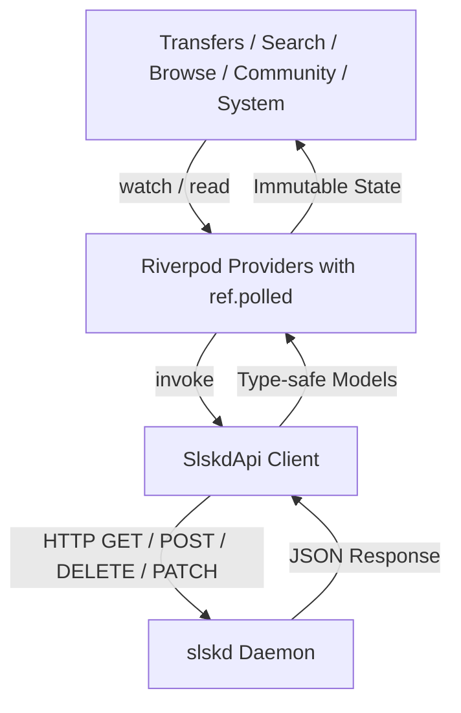

# slskd service (`service_slskd`)

`service_slskd` is Atrium's native client for [slskd](https://github.com/slskd/slskd), the modern, docker-first daemon for the Soulseek peer-to-peer music sharing network.

## Architecture & Protocol

slskd exposes a RESTful HTTP API documented with OpenAPI/Swagger.

### 1. Authentication
- Authenticates using the `X-Api-Key` header mapped from `Instance.apiKey`.
- Health probe verifies connectivity against `GET /api/v0/application` directly and checks the server's connected state.

### 2. Provider Lifecycle & Polling
- Polling uses `ref.polled` on the instance's configured `pollingIntervalSeconds`, ensuring requests do not overlap on high-latency links.
- On failure, `ref.polled` backs off automatically by an error backoff factor.
- Providers define `retry: (int _, Object __) => null` to prevent unbacked retry storms when the daemon is offline.

## Features & Navigation

The interface uses standard Material 3 with 5 primary navigation tabs via `AtriumBottomNav`:

### 1. Transfers Hub (`SlskdTransfersTab`)
- **Queue Metrics**: Active, Queued, Completed, and Failed counts with live aggregate upload and download speeds.
- **Dual Presentation**: Grouped view (by peer user) and flat itemized view with 1-tap toggle.
- **Controls & Actions**: Real-time progress indicators, queue ranking, priority adjustments, pause/resume, and removal.
- **Filter Sheet**: Dynamic filtering by direction (Download/Upload), state, and search query.
- **Analytics Sheet**: Transfer telemetry charts, top peer transfer leaderboard, and Pareto failure distribution analysis.

### 2. P2P Search (`SlskdSearchTab`)
- **Concurrent Searches**: Multiple active search queries with real-time status chips and automatic polling until search completion.
- **Result Presentation**: Album-grouped cards with track listings, bitrate badges, and 1-tap batch enqueue.
- **Filter Options**: Filter by audio format (FLAC, MP3, WAV, AAC), free upload slot availability, and locked shares.

### 3. Peer Shares Browser (`SlskdBrowseTab`)
- **Hierarchical Navigation**: Breadcrumb folder traversal through remote user shared music directories.
- **Folder Inspection**: Track counts, locked badges, and 1-tap complete folder enqueue.
- **User Profile**: Peer biography, status indicators, and speed statistics.

### 4. Community Hub (`SlskdCommunityTab`)
- **Public Chat Rooms**: Room list with member counts, active ticker announcements, message logs, and room discovery sheet.
- **Direct Messages**: 1-on-1 private chat conversations with message history, peer presence, and user actions.
- **Room Members Sheet**: Online participant roster with dynamic Material 3 presence dots.

### 5. System & Health (`SlskdSystemTab`)
- **Health Tab**: Soulseek server connection status, VPN status, uptime, and system diagnostic counters.
- **Shares Tab**: Local shared folders list with scanning progress and shared contents explorer.
- **Logs Tab**: Historical application logs with log level filters (Error, Warning, Information, Debug) and text search.

## Theming & Conventions

- **Dynamic Material 3**: Strict usage of `Theme.of(context).colorScheme` without raw hex colors.
- **System Insets**: Uses `AtriumBottomNav` for proper padding on devices with gesture or 3-button navigation.
- **Indicators**: Uses `ExpressiveProgressIndicator` and `LinearProgressIndicatorM3E` for loading and transfer feedback.
- **Navigation**: All modal bottom sheets and confirmation dialogs explicitly pass `useRootNavigator: true`.

## Testing

The package includes comprehensive tests:
- **API Unit Tests** (`slskd_api_test.dart`): Mock Dio adapter testing for endpoints and error handling.
- **UI & Screenshot Suites** (`slskd_*_ui_test.dart`): Responsive widget tests across all 5 tabs and subviews with cross-platform font loading.
